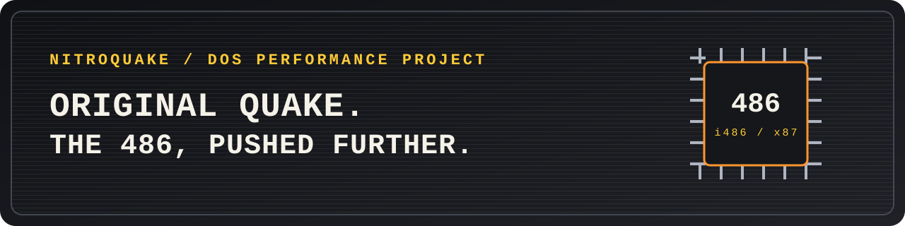
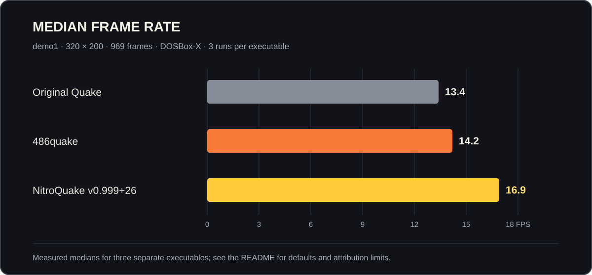

<h1 align="center">NitroQuake</h1>

<p align="center">
  
</p>

<p align="center">
  
  
</p>

<p align="center"><strong>Original Quake. The 486, pushed further.</strong><br>
MS-DOS · i486 · x87 · software rendering</p>

NitroQuake is a performance-engineering project for the original Quake engine.
It tunes the DOS software renderer and other measured hot paths for 486-class
machines, with one goal: make the same game run faster while preserving its
behavior and rendered output.

## Why Quake still matters

When Quake arrived in 1996, it made a fully spatial 3D world the center of a
first-person shooter. The engine had to transform and clip geometry, traverse
the world, map textures, apply lighting, draw polygonal models, and maintain a
depth buffer every frame. Its original DOS release did this in software; the
Quake manual describes separate DOS, Windows, and accelerator-targeted builds
with the same gameplay. The manual also states that Quake requires a
floating-point unit for its complex 3D math. That requirement captures the era's
hardware challenge in one line. ([Original Quake manual, archived copy](https://manualzz.com/doc/31405946/id-software-quake-video-game-manual); [id Software's Quake source release](https://github.com/id-Software/Quake))

A “486” was not one uniform machine. Intel 486, AMD Am486, and Cyrix Cx486
systems differed in clock rate, cache, floating-point performance, memory, and
video hardware. Quake's FPU requirement also matters: some 486 systems need a
math coprocessor to run it at all. On this class of PC, a handful of cycles in
a texture span or edge loop can affect the entire frame, and emulator timing
does not reproduce every cost of a physical board.

## The NitroQuake mission

The work stays close to Quake's original MS-DOS engine, especially its x86
software renderer. C and GNU assembly are built for the i486 instruction set;
the renderer's C-reference configuration and strict linked-instruction audit
provide comparison and compatibility checks. Optimization work focuses on
real hot paths such as texture and depth spans, edge traversal, surfaces, and
polygonal models.

The project is performance-only. New gameplay, changes to game logic or rules,
visual effects, an alternate modern renderer, and changes to the original
experience are outside scope. Correct output is part of the optimization:
matched runs use deterministic demos and image, color/depth, or simulation
checks appropriate to the change. Timed runs are kept separate from diagnostic
profiling, whose instrumentation changes runtime cost.

## A measured comparison

This reference comparison was recorded on **2026-11-08** using three delivered
executables at **320×200** and the same 969-frame `demo1` workload. Each
executable was run three times; the table reports each executable's median
frame rate and elapsed time.

| Executable | Resolution | Median FPS | Median time |
| --- | ---: | ---: | ---: |
| Original `Quake.exe` | 320×200 | 13.4 | 72.4 s |
| `486quake.exe` | 320×200 | 14.2 | 68.2 s |
| NitroQuake `v0.999+26` | 320×200 | 16.9 | 57.4 s |

<p align="center">
  
</p>

These figures come from DOSBox-X 2026.08.31 using its dynamic core, an i486/387
profile at a fixed 33,445 cycles, and 32 MiB of emulated memory. The three
executables used the same demo, arguments, emulator, DPMI host, and game data.
Their delivered defaults still differ: the stock builds use a 600 KiB surface
cache, NitroQuake uses 2400 KiB, and their video backends are not identical.
Pixel and depth parity against both stock executables has not been established.

Read the result as a comparison between three complete engine builds under one
emulated workload. It does not isolate the cumulative gain from NitroQuake's
own optimizations, and it is not a physical-486 measurement. Individual
optimization gains require matched before/after builds, repeated uninstrumented
runs, and correctness evidence. A separate local-server leaf-cache experiment
reported a 0.387% pooled gain on its own workloads; client `demo1` does not run
that server path, so that result is not included here. See the
[benchmark record and historical context](benchmarks/docs/BENCHMARK-COMPARISON.md).

## How the work is qualified

- **486 constraints:** keep generated instructions within the i486 target and
  inspect x87 scheduling, register pressure, and memory traffic on their actual
  hot paths.
- **Repeatable timing:** pin the DOSBox-X profile, game data, demo, resolution,
  and frame count; time normal uninstrumented executables.
- **Rendering correctness:** compare deterministic color/depth streams or
  captured frames, plus simulation state where the change touches gameplay
  execution.
- **Evidence over intuition:** profile to locate work, then measure a focused
  candidate against a matched control. Emulator results help rank changes;
  acceptance on a physical 486 remains separate evidence.

## Build and repository layout

This workspace keeps the game and benchmark suite in separate Git histories.
The game source and DJGPP build are in the `quake/` checkout; this outer
repository owns `benchmarks/` and the workspace documentation. The `quake/`
entry is a Git link, not a configured submodule, so cloning the outer repository
alone does not fetch the game source. See the
[repository boundary guide](docs/repository-layout.md).

With both checkouts present, build from the game checkout:

```powershell
Set-Location .\quake
pwsh -NoProfile -File tools/bootstrap-dos.ps1
pwsh -NoProfile -File tools/build-dos.ps1 -Configuration i486-release
```

The pinned DJGPP toolchain builds the DOS executable. Runtime play requires
legally obtained Quake PAK files; those game data files are not distributed
here. The game checkout's `BUILD-DOS.md` documents its full build and
verification workflows. For benchmark setup and commands, start with the
[benchmark suite guide](benchmarks/README.md).

## Project references

- [Repository boundaries and ownership](docs/repository-layout.md)
- [Benchmark setup and operations](benchmarks/README.md)
- [Repository contribution guidelines](docs/repository-guidelines.md)
- [Quake DOS benchmark comparison](benchmarks/docs/BENCHMARK-COMPARISON.md)
- [Original Quake manual](https://manualzz.com/doc/31405946/id-software-quake-video-game-manual)
- [id Software Quake source release](https://github.com/id-Software/Quake)
