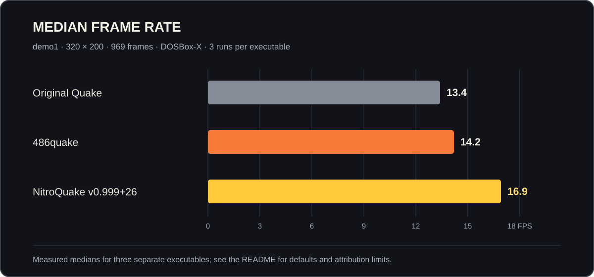

# Quake DOS benchmark comparison

## Reference result (2026-11-08)

The same 969-frame `demo1` workload was run at **320×200** with three normal
release executables. Each executable completed three timed runs; the table
shows its median FPS and elapsed time.

| Executable | Median FPS | Median time |
| --- | ---: | ---: |
| Original `Quake.exe` | 13.4 | 72.4 s |
| `486quake.exe` | 14.2 | 68.2 s |
| NitroQuake `v0.999+26` | 16.9 | 57.4 s |

### Measurement setup

- DOSBox-X 2026.08.31, dynamic core, i486 CPU / 387 FPU profile.
- Fixed 33,445 emulated cycles, 32 MiB, and a 320×200 display.
- 969 frames of `demo1`, three runs per executable; report per-executable medians.
- Arguments, DPMI host, emulator, demo, and game data held constant.

### What the comparison means

These are medians from three delivered executables, not matched before/after
builds that differ only by NitroQuake optimizations. The defaults differ: stock
Quake and 486Quake use a 600 KiB surface cache, NitroQuake uses 2400 KiB, and
the video backends are not identical. Stock color/depth parity was not measured.
The comparison therefore does not isolate a cumulative NitroQuake optimization
gain or establish frame rate on a physical 486.

The separate AI leaf-cache experiment measured a 0.387% pooled gain on local
server workloads. The client `demo1` comparison does not execute that server
path, so the result is not included above. Individual optimization claims need
matched controls, repeated uninstrumented timing, and correctness evidence.

The detailed source record remains in the game repository at
`quake/docs/ledger/2026-11-08-engine-wide-profile-and-ai-cache.md`. Older
measurements and their original context are retained in the
[comparison history](BENCHMARK-COMPARISON-HISTORY.md).
