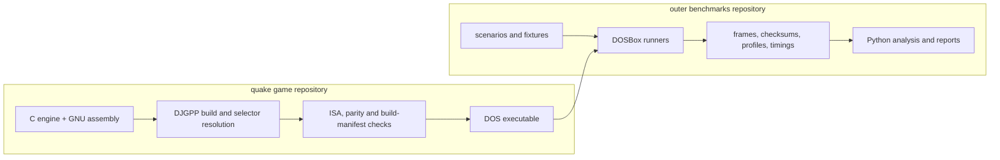

# NitroQuake Architectural Assessment

**Assessment date:** 2026-11-14  
**Reviewed revisions:** outer repository `8a64282`; game repository `db4831f`  
**Scope:** source, build and benchmark infrastructure review. This is a source-level assessment; no code, build, runtime, or performance tests were run.

## Executive summary

NitroQuake has a sound high-level repository split: the game checkout owns the DOS game, DJGPP build, assembly, ISA proofs, and native fixtures; the outer checkout owns DOSBox orchestration, scenarios, captured-frame checks, analysis, and reports. The benchmark suite consumes an explicit game-root/build interface, which keeps the game independently buildable. This split and the project's parity/provenance practices are valuable foundations.

The main architectural costs are concentrated inside the game checkout. The runtime remains a classic, globally stateful Quake engine with a broad shared-header surface. Assembly selection and experimental build controls have grown into a large configuration surface. There is also a concrete stack-pressure concern: the render function reserves a 64,000-byte warp buffer in its frame on every call, even though warp rendering is conditional. These issues favor incremental boundary tightening and evidence-driven configuration reduction over a wholesale engine rewrite.

The highest-value next steps are to move warp scratch out of the render stack frame, reduce and formalize supported renderer/build profiles, and add targeted validation/provenance for the new ISO launcher path. Longer-term work should narrow subsystem dependencies, decouple build identity from the optimization ledger's full history, and make workspace checkout setup self-checking.

## Architecture and data flow

### Repository and build boundary

The outer repository coordinates two histories. `quake/` is the standalone game repository; `benchmarks/` owns Python analysis, fixtures, scenarios, emulator orchestration, and reports. The suite can target an explicit game checkout through `-GameRoot` or `NITROQUAKE_GAME_ROOT`, and delegates game builds to `quake/tools/build-dos.ps1`. Repository ownership and integration contracts are described in [repository-layout.md](repository-layout.md).

### Runtime flow

The frame loop in [host.c](../quake/src/core/host.c#L681) polls networking, advances server/game state, reads client state, and updates the screen. Rendering flows through [screen.c](../quake/src/client/screen.c#L1133), [view.c](../quake/src/client/view.c#L1090), and [r_main.c](../quake/src/renderer/r_main.c#L1079). The software renderer traverses BSP/world surfaces, builds spans and rasterizes textures, depth, aliases, sprites, and particles before VGA/VESA presentation. Game logic includes a QuakeC interpreter in [pr_exec.c](../quake/src/server/pr_exec.c#L361), entity physics in [sv_phys.c](../quake/src/server/sv_phys.c#L1507), and world collision/area-tree code.

This is a tightly integrated, predominantly single-process engine. Rendering and game subsystems communicate through shared globals and legacy headers rather than independently owned services. That is consistent with the original engine's constraints, but makes local changes harder to reason about and increases the cost of proving C/assembly calling-convention and state parity.

### Memory and rendering model

The game uses contiguous DOS-oriented arena allocations for low/high hunk memory, zone, cache, and video-related buffers. Surface cache sizing is explicit in [d_local.h](../quake/src/renderer/d_local.h#L64), with a 2.4 MiB default and recorded tradeoff. Current profiling notes report no surface-cache thrash for the reviewed scenario. This specialized model is a strength for predictable DOS memory ownership; preserve it unless measurements identify a concrete limitation.

The renderer selects a warp buffer through [d_init.c](../quake/src/renderer/d_init.c#L147). The render frame-control assembly include reserves the 320x200-byte buffer as part of the render stack frame; details and the risk are in finding A1 below.

## Strengths to preserve

- **Clear ownership contract.** Game source/build and benchmark orchestration have different owners and can be used independently. The suite's explicit game-root support avoids making the game depend on the benchmark checkout.
- **Toolchain and ISA discipline.** The game pins the DJGPP toolchain and checks resolved build flags, supported CPU targets, and source/object ISA properties. Native C references and assembly parity fixtures provide an unusually useful safety net for low-level optimization.
- **Evidence-aware performance reporting.** Existing reports distinguish DOSBox timing from real hardware acceptance and separate timedemo, renderer replay, and VBE presentation-copy measurements. Keep these measurement classes distinct.
- **DOS-aware memory and cache design.** Arena allocation and explicit surface-cache sizing fit the target environment. Existing evidence does not justify replacing these structures wholesale.
- **A useful ownership-selection pattern.** `selectors.ps1` centralizes data-driven selector mappings. Reducing the surface area should build on that table rather than introduce another parallel selection mechanism.

## Prioritized findings

Ratings are qualitative: **Impact** is the expected architectural or user-visible consequence; **Effort** is an approximate implementation cost; **Risk** is the chance of regressions during a change. Performance figures below are source/report evidence, not claims of real-hardware FPS gain.

| ID | Priority | Finding | Impact | Effort | Change risk |
| --- | --- | --- | --- | --- | --- |
| A1 | P1 | 64 KiB render-local warp buffer creates avoidable stack pressure | High | Low–medium | Medium |
| A2 | P1 | Renderer/build configuration and experiment surface is too broad | High maintenance cost | Medium | Medium |
| A3 | P1 | Performance decisions need a stable profile policy and representative evidence | High potential | Medium | Medium |
| A4 | P2 | Broad shared headers and flat source layout hide subsystem boundaries | Medium | Medium–high | Medium–high |
| A5 | P2 | Build identity is coupled to full Git history and optimization-ledger inventory | Medium operational cost | Medium | Low–medium |
| A6 | P2 | ISO launcher path has incomplete suite-specific validation/provenance | Medium reliability risk | Low–medium | Low |
| A7 | P3 | The nested game gitlink is not a self-contained submodule checkout | Low–medium onboarding cost | Low | Low |

### A1. Move the warp buffer out of the render stack frame

**Evidence.** `WARP_WIDTH` × `WARP_HEIGHT` is 320 × 200 in [d_iface.h](../quake/src/d_iface.h#L22). [r_main.c](../quake/src/renderer/r_main.c#L1081) declares the 64,000-byte local buffer. [r_framecontrol_release.inc](../quake/src/renderer/r_framecontrol_release.inc#L2539) records its frame-local lifetime and reserves 64,012 bytes with `subl $64012, %esp` at line 2544. Warp rendering is conditional, but the frame reservation occurs on entry. A stack-depth check exists in `r_main.c` around lines 1218–1224, while the DOS stack high-water check in [sys_dos.c](../quake/src/platform/dos/sys_dos.c#L75) is disabled under `#if 0`.

**Why it matters.** A 64 KiB frame is large relative to DOS stack budgets and consumes that stack capacity even on non-warp frames. This is a concrete memory-safety and headroom concern, not a measured crash report. It can also make future stack use in the render call chain harder to validate.

**Recommendation.** Give the warp scratch buffer a long-lived owner in video/renderer initialization, or allocate it from an explicitly budgeted scratch arena. Preserve behavior when allocation is unavailable and preserve the low-memory fallback. Re-enable or replace stack high-water instrumentation, record the configured stack budget, and verify the largest render call path under representative warp and non-warp cases.

**Trade-off.** A shared buffer matches the current single-threaded renderer, but its ownership and lifetime should be explicit. If nested/reentrant rendering is possible in any supported path, document or guard that assumption.

### A2. Shrink and formalize the build/renderer configuration surface

**Evidence.** `quake/tools/build-dos.ps1` exposes 141 implementation-selection parameters in the reviewed source inventory, in addition to candidate/profile controls. It also exposes measurement-only probes (`EdgeScanProbe`, `SpanSetupProbe`, `RenderFaceProbe`, and `AliasGlueProbe`) near lines 98–109. [selectors.ps1](../quake/tools/selectors.ps1#L182) centralizes a substantial selector table (166 hashtable entries in the inventory).

**Why it matters.** A large parameter surface increases the number of configurations that can accidentally diverge and makes it difficult to see which combinations are supported product profiles versus experiments. The problem is maintenance and validation complexity; the count alone does not prove build instability.

**Recommendation.** Declare a small supported set, at minimum an i486 release profile and a C-reference profile. Put profiling/measurement probes behind a clearly separate BENCH or diagnostic mode, with generated resolved-configuration manifests. Keep one source of truth for selector ownership and provide a concise profile summary instead of requiring users to reason about many independent switches. Retain experimental variants only when they have an owner, correctness/parity evidence, a matched performance result, and a review date.

### A3. Base renderer changes on a stable performance policy

**Evidence.** The default-C profile notes in [optimization-opportunities.md](../benchmarks/docs/optimization-opportunities.md#L39) report one instrumented demo1 run at 320×200 under DOSBox-X. Corrected timing shares are texture spans 28.249%, world BSP 13.040%, alias raster 12.722%, Z work 11.075%, edge scan 10.064%, and surface cache 9.137% (lines 53–62). The same record reports 3,512,959 texture segments, 43,955,018 texture pixels, zero unit-stride segments, and no surface-cache thrash (lines 68–72). Nearby comparisons report BSP C/ASM nearly tied (C +0.024255%), `R_ClipEdge` C +0.383695%, mip unroll16 +0.0004656%, and warp unroll +0.321885% in their respective measurements.

**Interpretation and limits.** Textured spans have the largest measured share in this instrumented scenario, but the report does not establish the same ranking on physical 486 hardware or across the full workload. Small near-tie results should not drive permanent assembly complexity without repeatable, matched evidence. Lack of unit-stride segments also argues against assuming a simple contiguous-copy optimization is representative.

**Recommendation.** Establish a release policy that requires exact output/parity plus repeatable matched timing for each assembly selector. Compare component regressions as well as net scenario time. Keep instrumented profiling separate from timing runs and gather representative scenes before introducing new acceleration structures or replacing C with assembly. Treat measurements below noise/variance as ties and prefer the simpler implementation.

### A4. Narrow subsystem interfaces incrementally

**Evidence.** `quake/src` is a flat source directory. The reviewed inventory found 83 C files, 86 assembly files, 230 headers, and 36 include fragments. Seventy-nine of 83 C files include the broad [quakedef.h](../quake/src/quakedef.h). [d_local.h](../quake/src/renderer/d_local.h) exposes renderer scratch, callbacks, and rasterizer state. The renderer and game flow therefore share a wide compile-time dependency surface.

**Why it matters.** Broad headers make otherwise local changes trigger wide rebuilds and encourage direct access to unrelated global state. The flat layout also makes ownership harder to discover. This is accumulated legacy coupling, not a reason to rewrite Quake's data model wholesale.

**Recommendation.** Introduce narrow headers around stable seams (video/presentation, renderer interface, surface cache, world/collision, client/server), keeping `quakedef.h` as a compatibility umbrella during migration. Move test-only `bench486` fixtures toward a dedicated native-test area when their include/assembly contracts allow it. Preserve public symbols, calling conventions, and the supported C/assembly ABI. Use dependency scans to prevent the new interfaces from collapsing back into global includes.

### A5. Decouple build identity from complete optimization history

**Evidence.** [optimization-history.py](../quake/tools/optimization-history.py#L35) scans documentation and ledger records, and around line 120 requires full `git rev-list HEAD` history. [BUILD-DOS.md](../quake/BUILD-DOS.md#L101) documents build numbering based on accepted/rejected optimization attempts and the full-history requirement. The repository layout guide also calls the ledger build-identity provenance.

**Why it matters.** A shallow or source-archive checkout can be unable to produce the same build identity, and documentation/history inventory is an indirect input to executable identity. This couples reproducibility to Git availability and historical bookkeeping.

**Recommendation.** Define build identity from immutable inputs: source revision/tree fingerprint, resolved compiler/toolchain identity, and resolved selector/configuration manifest. Keep the optimization-attempt count and ledger reference as report metadata for historical context, rather than as an input needed to identify the binary. Preserve historical ledger contents and avoid rewriting prior evidence.

### A6. Complete ISO launcher validation and provenance

**Evidence.** The new portable launcher ISO path in `benchmarks/tools/build-launcher-iso.ps1` stages the game executable, legal user-provided PAKs, CWSDPMI, and a small launcher/preparation program; it hashes payload files and writes a sidecar with game revision and ISO/payload hashes. The ISO writer is custom (`build-iso9660.py`). The reviewed host-test references in `benchmarks/tools/run-tests.ps1` do not include ISO-specific validation, and the sidecar does not record the benchmark-suite revision or toolchain/source hashes.

**Why it matters.** The ISO builder is a new binary-format and packaging path. Hashing the payload is good, but without a direct content/format test and fuller provenance, it can be hard to diagnose whether an artifact changed because of game inputs, suite tooling, or toolchain changes.

**Recommendation.** Add host-side tests for ISO structure, file names, extents, and payload hashes, plus a DOS launch smoke check in the runtime suite. Extend the sidecar with the benchmark suite revision and pinned toolchain/build-input identities. Keep licensed PAK handling local and out of version control.

### A7. Make the workspace gitlink setup self-checking

**Evidence.** [README.md](../README.md#L14) and [repository-layout.md](repository-layout.md) explain that `quake/` is a nested game checkout represented by an outer gitlink rather than an ordinary configured submodule. The layout guide documents independent histories and full-history checkout requirements.

**Why it matters.** A fresh outer checkout can have a missing or wrong game checkout even though the outer repository itself appears valid. The explicit documentation helps, but currently leaves setup correctness dependent on operator steps.

**Recommendation.** Add a small read-only workspace check/bootstrap command that reports outer and nested revisions, confirms the gitlink target, validates expected full-history/toolchain prerequisites, and prints the appropriate clone/worktree commands. It should not fetch, reset, or replace a developer's checkout implicitly.

## Prioritized roadmap

### Quick wins (days to a few weeks)

1. **Establish a stack budget and remove the 64 KiB per-frame reservation.** Give warp scratch a renderer/video lifetime; verify low-memory fallback and stack headroom. (A1; high impact, low–medium effort.)
2. **Publish supported build profiles and isolate measurement probes.** Emit a resolved profile manifest and make unsupported selector combinations explicit. (A2; medium effort, low–medium risk.)
3. **Add ISO host validation and provenance fields.** Cover generated contents and format, then record suite/toolchain identities in the sidecar. (A6; low–medium effort.)
4. **Refresh renderer ownership/call-graph evidence with a source revision.** Label historical snapshots clearly and avoid treating unweighted selector counts as current runtime cost. (A2/A3; low effort.)
5. **Add a workspace verification command.** Check revisions, gitlink, and prerequisites without mutating the checkout. (A7; low effort.)

### Substantial engineering opportunities (several weeks or more)

1. **Adopt a performance-based assembly retention policy.** Reduce low-value selector variants after parity and matched timing review, while retaining the C-reference path and historical evidence. Report component regressions as well as net scenario gains. (A2/A3.)
2. **Create narrow subsystem dependency seams.** Migrate headers and scratch ownership incrementally, preserving C/assembly interfaces and supported CPU targets. Avoid a wholesale rewrite. (A4.)
3. **Make build identity independent of complete Git/ledger history.** Use a deterministic source/toolchain/configuration fingerprint and keep ledger counts as metadata. (A5.)
4. **Expand representative performance evidence.** Compare fixed, repeated renderer and whole-engine workloads separately; include instrumented-vs-uninstrumented distinction and real-hardware results when available. Do not convert DOSBox-only evidence into hardware claims. (A3.)

## Recommended decision principles

- Keep the current game/benchmark repository ownership split and its explicit build interface.
- Preserve the arena allocator and surface-cache design unless measured evidence justifies replacing them.
- Require correctness and exact parity before accepting a low-level renderer change; require repeated, matched timing before claiming speedup.
- Keep DOSBox, native hardware, renderer-only, whole-engine, and presentation-copy results labeled as separate measurement classes.
- Prefer fewer supported profiles and narrower contracts over additional independent build switches.
- Migrate legacy global interfaces gradually, with C/assembly ABI compatibility as a hard constraint.

## Review limits

This assessment is based on source and documentation inspection at the revisions listed above. It did not run builds, tests, emulators, static-analysis tools, or real-hardware benchmarks. Performance findings are only as representative as the cited report scenarios, and the 64 KiB stack reservation is identified as a structural risk rather than a demonstrated runtime failure.
