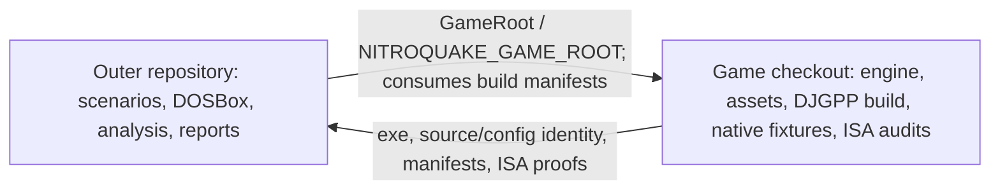
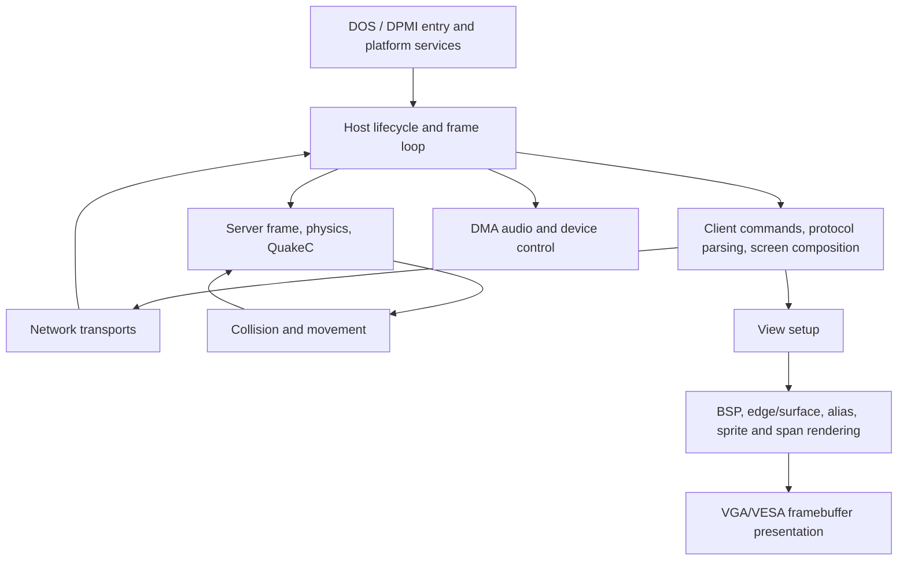

# NitroQuake Architecture Assessment — Current Tip

## Review scope

| Item | Reviewed state |
| --- | --- |
| Review date | 2026-11-17 |
| Outer workspace | `fbf14a84a7f496b200c25680480b5e6082c85898` |
| Game checkout reviewed | `432ae1afaf00e3551d6564ad94fcd4263c5708a6` |
| Latest source-affecting game commit | `644fb3a48daad2b5b8ff15a1db7887490b2b8e41` (`refactor(video): route colormap access through host interface`) |
| Follow-up game documentation commit | `dc6a21a` clarifies that optimization history is manifest provenance, not product identity |
| Checkout consistency at audit start | Both worktrees were clean; the outer `quake` gitlink matched the game checkout |
| Method | Source-level review of both repositories, source layout, public headers, build contracts, memory/stack model, and recorded validation evidence; this report is the only documentation output |
| Commands run for this review | Git status/revision and diff checks plus source/document inspection; no builds or tests rerun |

This is the current-state companion to the historical [November 16 assessment](architectural-assessment-2026-11-16.md). Older test and performance records remain valid only for their stated revisions and environments.

## Executive assessment

NitroQuake is a DOS-first Quake engine optimized for i486-class systems. Its architecture is deliberately specialized around DJGPP, DOS/DPMI services, VGA/VESA output, a software renderer, and a single-process host loop. The codebase is not organized as a portable engine with interchangeable platform backends; its main portability seam is the separation between engine code and DOS-specific services.

The repository split and source ownership are now visible and useful. The game checkout owns the executable, C and GNU assembly implementations, assets, compiler integration, native fixtures, and instruction-set verification. The outer checkout owns emulator execution, benchmark scenarios, host-side comparisons, and reports. Within the game, production code is grouped by subsystem, the old renderer assembly monolith is split, and BENCH fixtures have a test-owned location.

These boundaries are primarily organizational and build-time contracts. Runtime ownership is still broad: legacy global state, aggregate headers, assembly-visible data layouts, and selector-driven C/assembly variants cross subsystem lines. This is a reasonable compatibility position for a 486 product, but it means new work should narrow ownership incrementally rather than treat directory names as fully isolated modules.

No functional defect was established by this source-level review. The clearest open risks are physical-hardware qualification, the large normal renderer stack footprint, and the maintenance cost of shared global state and multiple implementation schedules.

## Repository and build boundaries

The outer repository records `quake/` as a gitlink to a standalone game history, not as an ordinary directory or a configured submodule. The workspace doctor checks outer, index, and nested revisions and dirty state. The benchmark suite can target another game checkout and is not imported by the game's builder.

| Boundary | Owns | Stable integration point |
| --- | --- | --- |
| Game build | DJGPP bootstrap, supported configurations, resolved compiler flags, source inventories, manifests, native artifacts, source-bound and linked ISA audits | `quake/tools/build-dos.ps1 -DumpFlags` |
| Experimental builds | Per-routine selectors and benchmark-only variants | Internal `build-dos-experimental.ps1`, called by benchmark tooling |
| Benchmark suite | DOSBox-X setup, staging, scenarios, timedemos, profiling collection, comparisons, charts, and run output | Explicit game root plus build manifests and recorded result schemas |
| Native fixtures | C/assembly oracle code that must compile against engine internals | Game-owned `src/tests/bench486/` interfaces |

The public game surface is intentionally small: `i486-release` and `c-reference`. Build identity is based on source revision and the resolved source/configuration fingerprint. Optimization-attempt count and inventory digest remain provenance in the manifest, so a shallow clone can build without pretending its history inventory is complete. The historical build-number sentence in [quake/README.md](../quake/README.md) was corrected in game commit `dc6a21a` to agree with [BUILD-DOS.md](../quake/BUILD-DOS.md) and [benchmarks/docs/INTERFACES.md](../benchmarks/docs/INTERFACES.md).

## Runtime architecture

`platform/dos/sys_dos.c` owns DOS startup and platform services, then calls `Host_Init` in `core/host.c`. The host initializes the memory arena, command and filesystem services, game data, server, and networking. Interactive startup also brings up input, video, drawing, renderer, audio, and client services; dedicated mode conditionally omits interactive facilities while sharing parts of the engine.

`Host_Frame` coordinates timing, input, command execution, network polling, local-client work, server simulation, remote-client traffic, and screen presentation. The client parses protocol messages and prepares views. The server advances physics and the QuakeC interpreter. Collision routines serve both server movement and world queries. The render path prepares view state, traverses the BSP, builds and scans edge/surface lists, draws brush entities, and emits textured/Z spans; alias models, sprites, particles, and overlays use separate paths. Video presents the indexed framebuffer. Audio is updated from the host and uses DOS DMA at its device boundary.

This is a largely single-threaded architecture with explicit shared state rather than an event-driven or job system. That keeps scheduling and memory use predictable for the target, while making state ownership and reentrancy less explicit.

## Source and interface boundaries

The game source tree has subsystem directories for `assets`, `audio`, `client`, `collision`, `core`, `memory`, `network`, `platform`, `renderer`, `server`, `tests`, and `video`. Recursive inventory under those directories finds 83 non-test C translation units, 98 assembly units, and one BENCH harness C unit. The top of `src/` still contains 49 headers, including compatibility and shared interfaces.

Public headers now identify renderer, video, memory, client, and server entry points, alongside narrower `host.h` and `host_assets.h`. Production C no longer directly includes the compatibility `quakedef.h`; `test-header-dependencies.py` enforces that inventory. The video colormap accessor in `host_assets.h` is a concrete narrow seam: video samples host-owned game data through `Host_GetColormap` instead of reading `host_colormap` directly.

The remaining compile-time graph is not narrow. `render.h` still imports `common.h`; `client.h` imports common, cvar, math, protocol, shared types, render, sound, and video interfaces; `server.h` imports `client.h`, which pulls client-facing dependencies into server consumers. `common.h` owns message/buffer/shared declarations and also includes renderer implementation declarations. The renderer's `r_shared.h` defines assembly-sensitive layouts and exports shared state; `r_local.h` remains a broad private header with more than one hundred external declarations. A clean direct-include inventory therefore does not mean transitive dependencies are small.

Mutable state remains visible across module seams. Renderer, host, client, server, video, model, and memory code communicate through globals and shared structures. This preserves established C/assembly ABI and avoids introducing indirection into pixel/span loops, but it makes ownership and test isolation less obvious. Treat narrow headers as a migration path; do not infer that a context-object conversion is currently safe or performance-neutral.

### Source ownership inventory

| Area | Primary responsibility | Main coupling to watch |
| --- | --- | --- |
| `core/` | Host lifecycle, commands, files, common engine services | Shared declarations and global host state |
| `client/` | Client state, messages, views, UI and input-facing behavior | Broad client state header and renderer/video/sound dependencies |
| `server/` | Server state, physics, networking protocol, QuakeC execution | `server.h` dependency on client types and shared edict/model data |
| `collision/` | Movement, tracing and collision helpers | Shared server/world structures and assembly layout contracts |
| `renderer/` | BSP/world, edges, surfaces, spans, alias models and effects | Broad renderer globals plus C/assembly structure and calling conventions |
| `video/`, `audio/`, `platform/` | DOS display/audio/system services | Hardware and DPMI assumptions; selected services are called from shared engine code |
| `memory/` | Zone, hunk and cache allocation | One contiguous DOS arena and global allocator state |
| `tests/bench486/` | Native C/assembly parity, profiling and benchmark fixtures | Deliberately reaches engine internals; should stay out of ordinary product ownership |

The renderer assembly split and fixture move address real ownership boundaries. Further file splitting should respond to recurring dependency leakage, conflicts, or review friction, not line count alone.

## Build profiles and implementation parity

The ordered selector table centralizes selector names, resolved flags, profile suffixes, assembly inclusion, and expected inventory. The current table has 163 entries; the release profile names 142 selectors, 138 of which select assembly-capable alternatives. Twenty-one entries are retained for benchmark, history, or reproduction use. The C-reference profile is a controlled comparison profile, not an all-C executable: its documented inventory has 92 assembly sources versus 98 in release.

Keeping handwritten assembly beside C implementations enables exact output comparison and matched measurements. It also expands the configuration surface: selector settings affect compiler/assembler flags, source selection, identity, object manifests, and test expectations. Release and profiling include schedules remain separate, so changes can still drift despite the central selector table. Prefer generated or cross-checked schedules if this becomes a demonstrated source of failures; do not discard the C oracle or merge schedules at the cost of opaque build behavior.

The build pipeline has strong target-specific guardrails: pinned DJGPP inputs, named shipping profiles, build manifests, source-bound and complete linked-image i486 instruction audits, release artifact pins, selector matrix checks, and assembly ABI/layout assertions. This is a substantive part of the architecture: the build is not a generic makefile but a controlled DOS toolchain orchestrator.

## Memory, stack, and performance constraints

The DOS allocator manages a contiguous engine block. A low-end zone and low/high hunk allocations share that block; cache blocks occupy the gap and can be moved or evicted as the hunk grows. Video buffers and other long-lived data live in the hunk. Budget figures must be interpreted by pool and overlap, not added as independent totals.

At 320x200, the documented standard engine minimum is 5,570,560 bytes, the registered-data minimum is 6,619,136 bytes, the default zone is 49,152 bytes, the video hunk is about 2.65 MB, and the 64,000-byte warp image is allocated for renderer lifetime. The normal edge/surface path still has 128,096 bytes of local arrays; the i486 release edge frame is 128,176 generated bytes. The warp allocation removes its 64 KB image from ordinary `R_RenderView_` frames. If allocation fails, a separate stack fallback remains guarded.

The build checks generated frames and cross-checks the runtime model for release, C-reference, and PROFILE486 configurations. Their documented requirements are:

| Configuration | Normal path | Warp fallback |
| --- | --- | --- |
| i486 release | `172,868 + 128 * world_depth` bytes | `236,884 + 128 * world_depth` bytes |
| C reference | `172,792 + 124 * world_depth` bytes | `236,808 + 124 * world_depth` bytes |
| PROFILE486 | `172,992 + 136 * world_depth` bytes | `237,008 + 136 * world_depth` bytes |

Dispatch reads ESP and DJGPP stack bounds before entering large render frames, rejects a normal render that does not fit, and disables waterwarp when only fallback capacity is short. The recorded DOSBox-X/CWSDPMI capture at BSP depth 87 had 523,940 bytes available: 184,004 normal requirement and 248,020 fallback requirement, leaving 339,936 and 275,920 bytes of headroom, respectively. These measurements describe that DPMI emulator setup, not a guaranteed stack size on other systems.

Pool-level map-load diagnostics have improved since the earlier assessment. The opt-in DOSBox-X/CWSDPMI trace identifies failed low-hunk requests: standard minimum e1m1 requested 107,984 bytes with 47,760 available; a 7,241,728-byte e1m1 run requested 22,000 with 15,056 available; and registered-game cases requested 129,772 or 141,172 bytes. At 7,258,112 bytes, the tested e1m1 load completed. This explains the observed allocation failure for those runs, but does not establish general map minimums for other game data, DPMI hosts, or hardware. See [memory-budget.md](../quake/docs/memory-budget.md).

The remaining physical stack and timing evidence gap is material. Generated stack checks and DOSBox reduced-capacity tests improve confidence, but physical 486 and DPMI behavior has not been qualified. The user has indicated physical 486 access is not currently available. Keep any future movement of the edge/surface arrays conditional on evidence: it exchanges stack for scarce hunk memory and could change 486 addressing/cache behavior. Require exact color/Z parity and matched 486 timings before accepting such a migration.

## Verification and evidence architecture

Validation is deliberately split by what it can prove:

| Evidence | What it establishes | Current scope and limit |
| --- | --- | --- |
| Game host/source checks | Header contracts, source maps, build manifests, selectors, tool scripts and fixtures | The recorded layout/header checks passed at game revision `644fb3a`; they were not rerun for this review |
| Build and ISA gates | Compiler integration, generated stack frames, runtime formula agreement and i486 instruction constraints | Release, C-reference and PROFILE486 checks are recorded; latest current-tip release preflight is pinned at game revision `432ae1a` |
| Benchmark host suite | Analysis, schema, staging, comparison and synthetic ISO behavior | The recorded suite result is 22/22; no host suite was run for this review |
| Rendering parity | Deterministic equality for the tested profiles/workloads | Current pinned emulator preflight matched color and Z streams for the control/candidate builds on demo1/2/3; the comparison is a single correctness run, not timing |
| Earlier broad C/assembly parity | Wider scene coverage between C-reference and selector builds | Seven-scene parity and a three-demo C-reference/assembly comparison are recorded at earlier source revisions; do not present them as a rerun at `432ae1a` |
| Emulator profiling/timing | Relative behavior under the recorded emulator configuration | Useful for screening and attribution, not physical 486 cycle claims |
| Physical acceptance | Real CPU timing, devices, startup and DPMI stack behavior | Pending; the acceptance procedure is documented in [PHYSICAL-486-ACCEPTANCE.md](../benchmarks/docs/PHYSICAL-486-ACCEPTANCE.md) |

This separation is a strength: source/layout checks, ISA compatibility, visual correctness, emulator timing, and hardware qualification are not conflated. Keep exact build, source, profile, executable, DPMI, PAK and scenario identity with new evidence.

## Prioritized findings

| Priority | Finding | Assessment |
| --- | --- | --- |
| P1 | Physical 486/DPMI qualification is pending | No conclusion about actual 486 performance, device compatibility, or target stack margin is justified without hardware evidence. |
| P1 | Normal renderer stack remains large | A generated/runtime model and preflight exist, but the ordinary edge/surface frame itself is about 128 KB and whole-path assumptions need synchronization with call graph changes. |
| P2 | Runtime ownership remains broad | Global state and transitive aggregate-header dependencies obscure ownership, especially across renderer, client, server, host and memory. |
| P2 | Build schedules still have parallel representations | The ordered selector table is a good central contract, but separate release/profile include schedules and C/assembly variants raise review and parity cost. |
| Resolved | User-facing build identity documentation drift | Game commit `dc6a21a` aligns `quake/README.md` with the source/configuration identity contract; build behavior did not change. |
| P3 | BENCH486 harness is large | It is correctly test-owned and split from normal host commands; decompose further only when the existing fixture grouping causes concrete maintenance friction. |

## Recommended incremental work

1. **Completed in game commit `dc6a21a`:** Correct the stale build-identity statement in `quake/README.md` so it agrees with `BUILD-DOS.md` and the benchmark interface contract.
2. Continue narrowing includes at the point of use. First reduce server/client transitive dependencies and split declarations from implementation-owned globals where a bounded change has clear consumers. Keep legacy symbols and calling conventions stable during migration.
3. Give renderer-owned mutable state smaller interfaces in stages. Preserve the existing assembly ABI and structure-layout assertions; avoid a broad context-object conversion until a measured prototype shows acceptable i486 code generation.
4. Keep generated-frame, runtime stack-formula, reduced-capacity and warp-fallback checks synchronized with renderer call-path changes. Record the physical target margin when hardware access becomes available.
5. Reduce schedule duplication only through a reviewable single source or explicit equivalence tests. Keep C-reference parity and historical selector profiles while they serve current correctness or measurement needs.
6. Treat the mapped low-memory traces as diagnostics for their recorded configurations, not universal minimums. Add new instrumentation only when another reproducible map or host failure remains unexplained.

## Review limits

This assessment describes checked-in source and documentation at the revisions in the review table and uses committed/recorded test and emulator results. It did not execute builds, host tests, DOSBox scenarios, or physical hardware runs. Both worktrees were clean at audit start and the gitlink matched. The follow-up made a documentation-only game change at `dc6a21a`; this outer update records that revision. No engine-source change is proposed; physical qualification and performance claims remain explicitly open.
